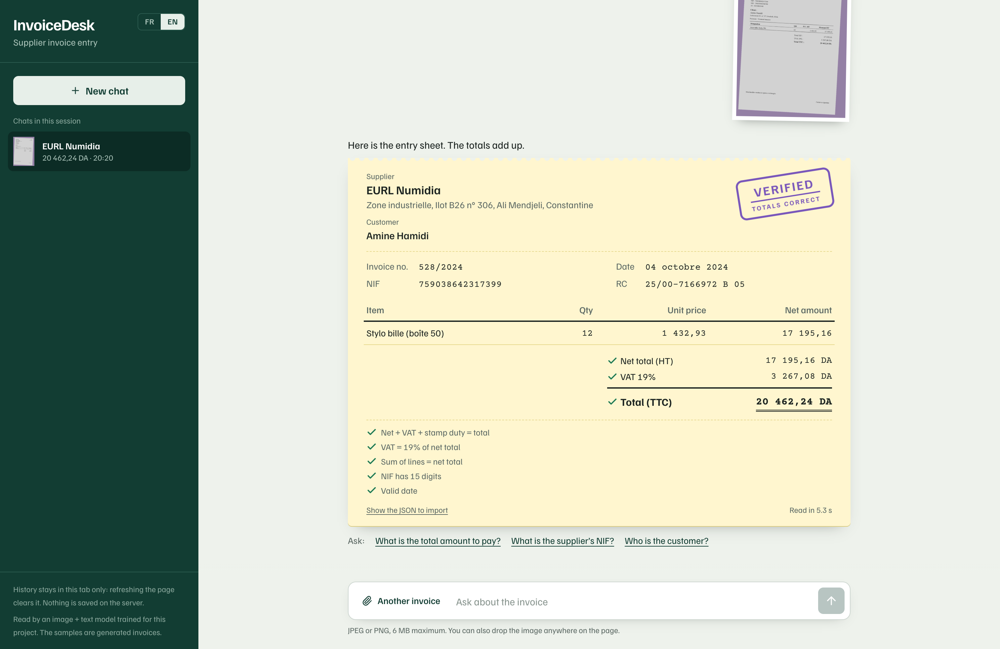
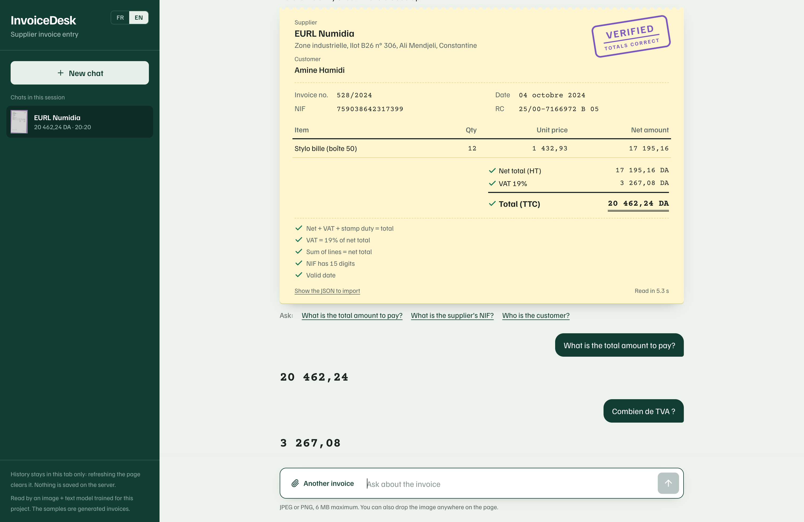
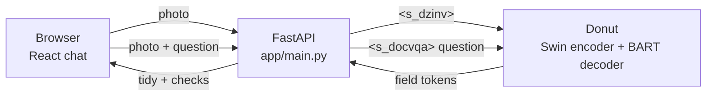
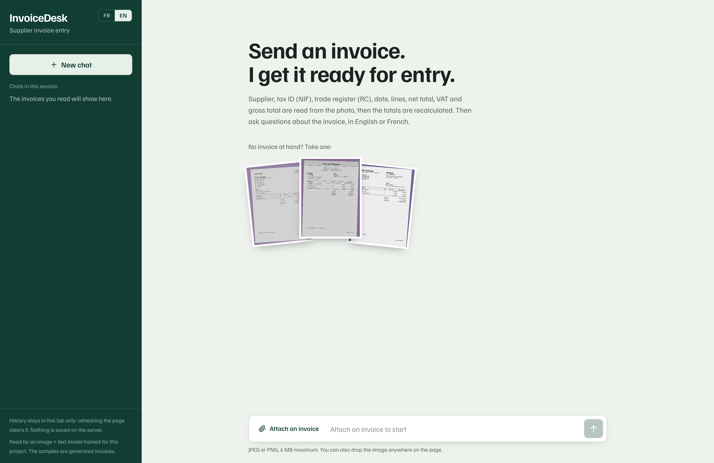
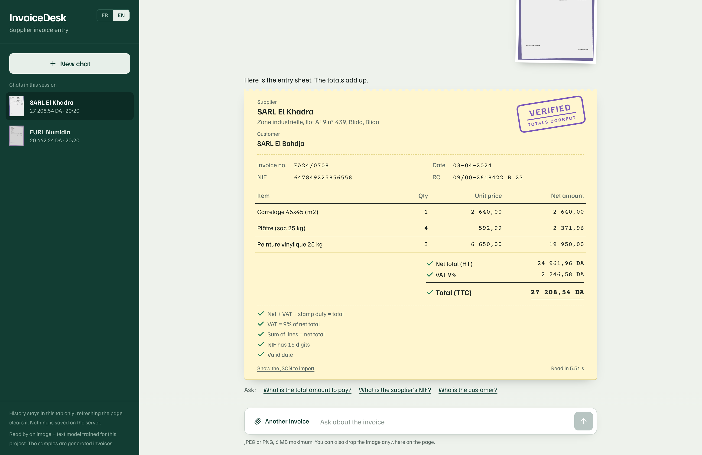
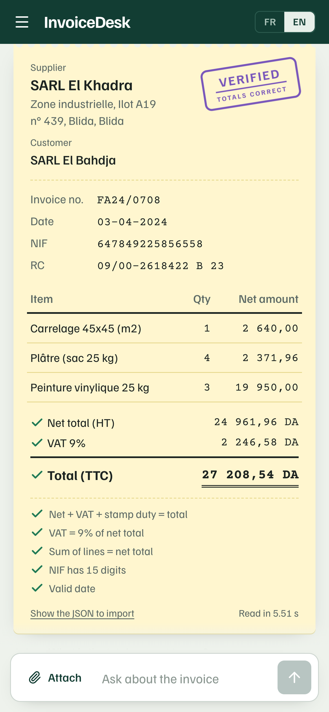

# InvoiceDesk

[](https://github.com/okba-bouziane/InvoiceDesk/actions/workflows/ci.yml)

**InvoiceDesk reads a photo of a supplier invoice and prepares it for bookkeeping.** You drop the image into a chat; it returns the fields an accountant types in (supplier, NIF, RC, invoice number, date, client, every line, total HT, TVA, stamp duty, total TTC), recalculates the totals, and then answers questions about the same image in French or English: *Quel est le montant TTC ? What is the supplier's NIF?*

The model is [Donut](https://huggingface.co/naver-clova-ix/donut-base), an image-to-text transformer that reads the pixels directly (no separate OCR step). I fine-tuned it on a Kaggle T4 GPU for three tasks at once: reading real receipts (CORD-v2, public), reading Algerian invoices, and answering questions about them. It is compared on the same test images with the usual approach, Tesseract OCR plus hand-written rules.

**Stack:** PyTorch · Hugging Face Transformers (Donut) · FastAPI · React 19 + Vite 8 + TypeScript 7 · TanStack Query · Zod · Tailwind CSS 4 · Vitest · pytest · Docker · Kaggle (T4 GPU) for training

> The Algerian invoices are generated by this project: companies, people, NIF / RC numbers and amounts are invented. There is no public dataset of Algerian invoices; see Data and Limitations.

| Reading an invoice | Questions about it |
| --- | --- |
|  |  |

## Results

All test images are unseen in training. The published model is **v3**; v2 is the same training with less variety (see What didn't work).

**Field F1:** every header field and every line-item value counts as one fact; a fact is right when the value matches exactly (spaces normalised).

| Test set | Tesseract + rules | v2 | **v3** |
| --- | --- | --- | --- |
| Invoices in the 6 training layouts (300) | 0.428 | 0.971 | **0.968** |
| Invoices in a layout and font never seen in training (300) | 0.477 | 0.593 | **0.698** |
| CORD-v2 test, real receipt photos (100) | n/a | 0.612 | **0.592** |

**Questions**, each worded differently from every training question, one per invoice:

| Test set | v2: exact match / ANLS | **v3: exact match / ANLS** |
| --- | --- | --- |
| Training layouts (300) | 0.427 / 0.470 | **0.777 / 0.846** |
| Unseen layout (300) | 0.410 / 0.477 | **0.737 / 0.796** |

- **The model reads what the rules miss.** On the training layouts it gets the supplier right on 100% of invoices (OCR + rules: 66%), the invoice number on 99% (25%) and every line of the item table on 94% (the rules do not attempt the table). 49.7% of invoices are read completely right, every field and every line; the baseline gets none.
- **Its weak field is the NIF.** 15 digits in a small font: right on 61.7% of invoices, usually one digit off. The OCR baseline is better there (82.7%), because a 15-digit number after `NIF :` is exactly what a regex is good at.
- **A new layout is much harder.** On the boxed layout with a monospace font, the model is right 84% of the time when it outputs a field (precision 0.839), but it misses 40% of them (recall 0.597): some outputs stop after one or two fields. The rules, which look for labels such as `NIF :` wherever they are, lose less there.
- **Real receipts:** on CORD (Indonesian shop receipts, the public benchmark) it reaches 0.592 field F1 at 1280x960 after 3 epochs. The Donut paper reports CORD results with a larger input, longer training and a different metric (tree edit distance), so the numbers are not comparable; I did not try to reproduce them.

Per field, v3 against the OCR baseline (share of invoices where the field is exactly right):

| Field | v3, training layouts | v3, unseen layout | OCR, training layouts | OCR, unseen layout |
| --- | --- | --- | --- | --- |
| Supplier | 1.000 | 0.437 | 0.663 | 0.117 |
| Supplier address | 0.957 | 0.000 | 0.303 | 0.000 |
| NIF | 0.617 | 0.220 | 0.827 | 0.927 |
| RC | 0.807 | 0.267 | 0.633 | 0.577 |
| Invoice number | 0.993 | 0.663 | 0.250 | 0.553 |
| Date | 0.990 | 0.770 | 0.647 | 0.940 |
| Client | 0.990 | 0.893 | 0.663 | 0.987 |
| Total HT | 0.997 | 0.707 | 0.623 | 0.770 |
| TVA rate | 1.000 | 0.733 | 0.740 | 0.937 |
| TVA | 0.983 | 0.717 | 0.620 | 0.783 |
| Stamp duty (when present) | 0.990 | 0.730 | 0.710 | 0.829 |
| Total TTC | 0.987 | 0.710 | 0.603 | 0.773 |
| Every line of the item table | 0.943 | 0.387 | 0 (not attempted) | 0 (not attempted) |

### The checks catch most reading errors

After reading, `invoicedesk/normalize.py` checks what a bookkeeper would check by hand: HT + TVA + stamp duty = TTC, TVA = rate × HT, the lines add up to HT, the NIF has 15 digits, the date exists. On v3's test output:

| Test set | Invoices with a misread checked value | Flagged by the checks | Correct invoices flagged |
| --- | --- | --- | --- |
| Training layouts | 130 of 300 | **88 (68%)** | 0 of 170 |
| Unseen layout | 263 of 300 | **193 (73%)** | 0 of 37 |

A value counts as misread when any amount, the TVA rate, a line amount, the NIF or the date differs from the label. The checks never fired on a correctly read invoice. The errors they miss are mostly a wrong NIF digit (the length is still 15) and a wrong date that is still a valid date. In the app, a failed check turns the stamp red and shows the computed value next to the one read.

### Speed

| | p50 | p95 |
| --- | --- | --- |
| v3 on a Kaggle T4 GPU, one invoice | 0.94 s | 1.23 s |
| Tesseract + rules on Kaggle's CPU, one invoice | 0.69 s | |

On a laptop CPU (Apple silicon, PyTorch) one invoice took between 4.7 and 7.1 s in the local runs for the screenshots, and a question about 1.2 s; that is a handful of runs, not a benchmark. Training took 135.5 minutes on one T4 (3 epochs of 6,800 training examples each: 800 receipts, 3,000 invoices and 3,000 question invoices, rendered on the fly).

`python scripts/report.py` prints every table above from `results/v3/` and `results/v2/` (metrics written by the training job, plus every prediction).

## How it works



- **One model, three tasks.** The first token the decoder receives says what to do: `<s_cord-v2>` parse a receipt, `<s_dzinv>` parse an Algerian invoice, `<s_docvqa><s_question>…</s_question><s_answer>` answer a question. The output is a token sequence such as `<s_vendor>SARL Atlas</s_vendor><s_items><s_name>…`, turned back into JSON by `invoicedesk/donut.py`.
- **Values are kept as printed** (`12 345,00`, `04 octobre 2024`), so the model learns to read, not to calculate. `invoicedesk/normalize.py` then gives an accounting system typed values (`12345.0`, `2024-10-04`) and runs the checks.
- **Model output is cleaned before it leaves the API** (`tidy`): a repeated field becomes one value, anything that is not a string is dropped, so the web app always receives the shape its Zod schema expects.
- **Nothing is stored.** Each request carries the image. The chat history lives only in the browser tab and is gone after a refresh; the server keeps no image, field or question.

### The web app

`web/` is a React 19 + TypeScript 7 app built with Vite 8. TanStack Query runs the requests, Zod validates every API response, Tailwind CSS 4 holds the design tokens. One chat per invoice, a history of the tab's chats in the sidebar, French and English (switchable, every message re-translates), and on phones the history opens as a drawer. In production FastAPI serves the built app from the same port.

| Start | History of the session | Phone |
| --- | --- | --- |
|  |  |  |

## Data

| Set | Source | License | Train | Validation | Test |
| --- | --- | --- | --- | --- | --- |
| Receipts | [`naver-clova-ix/cord-v2`](https://huggingface.co/datasets/naver-clova-ix/cord-v2), pinned to commit `7f0115a`: photos of Indonesian shop receipts, labelled by hand | CC BY 4.0 | 800 | 100 | 100 |
| Algerian invoices | `invoicedesk/synth.py`, generated | MIT (this repo) | 3,000 | 60 | 300 + 300 |
| Questions | `invoicedesk/qa.py`, generated from the invoice labels | MIT (this repo) | 3,000 invoices × 3 | | 300 + 300 |

**The generated invoices** follow what Algerian supplier invoices print: SARL / EURL / SPA / ETS company names, wilaya addresses, NIF and NIS (15 digits), RC (`16/00-1234567 B 19`), AI, French line items from six trades, TVA at 19% or 9%, a stamp-duty line on cash invoices, amounts written `12 345,00`, `12.345,00` or `12345,00`, and four date styles. Each page is rendered and then made to look photographed: rotation, blur, lighting, JPEG compression, and for part of the training set a perspective tilt and a shadow band.

- **Layouts.** Six fixed styles (three layouts × fonts) for training, validation and the first test set. v3 adds a seventh, *free* layout for training only, whose blocks, table style, labels and fonts change on every invoice.
- **Held-out test.** The second test set uses a layout and a font that never appear in training: the supplier block on the right, boxed metadata, an outlined item table, boxed totals, a monospace font. `tests/test_synth.py` fails if any of these reaches the training styles.
- **Questions.** About 10 wordings per field for training, in French and English. The test questions use other wordings, and `tests/test_qa.py` fails if a test wording is also a training wording.
- **Reproducible.** Every image is drawn from its seed; seeds never overlap between splits. The Kaggle job regenerates the same images, and v2 and v3 were scored on images with identical hashes.

## What didn't work

- **The first full training run scored 0.000 on every test set, with a normal-looking loss** (2.54 to 0.25). The outputs contained real pieces of the invoices in the wrong order (`obre` from *octobre*, `midi` from *Numidia*).
  - Cause: with transformers 4.57, `VisionEncoderDecoderModel` falls back to `ForCausalLMLoss`, which shifts the labels by one position. My training step had already shifted them, so the model learned to predict the token **two** steps ahead. Checked directly: the model's loss equalled the two-ahead cross-entropy to four decimals.
  - Fix: `invoicedesk/training.py` computes the next-token loss from the logits itself. `tests/test_training.py` builds a tiny random Donut offline and trains it on one sequence; with the old loss it decodes `5, 23, 23, 31, …` (every other token), the same failure as on Kaggle.
  - The job now stops after the first epoch if validation F1 is 0 on both tasks, so a bug like this costs 45 minutes instead of three hours.
- **v2 answered questions badly and fell apart on the new layout.** Its values were often right but attached to the wrong field: *"Total excluding VAT?"* returned the VAT rate. Training had 2 to 3 wordings per field and 6 layouts. v3 changed only the data (about 10 wordings per field and the free layout), same model, same settings, same test images: question exact match went from 0.427 to 0.777, unseen-layout F1 from 0.593 to 0.698, and the training layouts stayed level (0.971 to 0.968).
- **The model can repeat a field**, which the JSON parser turns into a list. The first API version passed that to the checks and crashed (it would have been a 500 in the demo). `tidy` now normalises every response, with a test.
- **Training on the laptop was not possible**: one step at 1280x960 ran out of Apple GPU memory. The local smoke test (`make smoke`) runs at 640x480 for a few steps to check the pipeline; real training runs on Kaggle.

## Run it

Requirements: Python 3.12, [uv](https://docs.astral.sh/uv/), Node 24. The trained model is about 780 MB.

```bash
uv sync
npm --prefix web ci
MODEL_DIR=models/invoicedesk uv run uvicorn app.main:app --port 7860   # API
npm --prefix web run dev                                                # http://localhost:5173
```

Or with Docker (builds the web app, serves everything on one port, mounts the model):

```bash
docker compose up --build    # http://localhost:7860
```

**Training on Kaggle.** The job is one private script with this repo's code embedded; it installs its dependencies, downloads CORD-v2 and Donut at pinned commits, generates the invoices from their seeds, runs the OCR baseline, trains, evaluates and leaves everything in its output.

```bash
# needs the Kaggle CLI and an API token
python kaggle/build_kernel.py --user <kaggle-username> --slug invoicedesk-train-v3 --train-args "--epochs 3 --hours 6 --workers 3"
kaggle kernels push -p build/kaggle-kernel
kaggle kernels output <kaggle-username>/invoicedesk-train-v3 -p build/kaggle-out
python scripts/report.py
```

## Tests

```bash
uv run pytest -q          # 48 tests
npm --prefix web test     # 18 tests
```

- **Python (48):** invoice generation (seeded, totals add up, identifier formats, no seed or style shared across splits, held-out style never in training), label ↔ token round trip, metrics, checks and typed values, `tidy` on odd model output, question templates (no test wording in training), the OCR rules, the training loss (the regression test above), and the API with a fake reader (fields, checks, upload limits, file type, rate limit).
- **Web (18):** API contract with Zod, check wording in both languages, the entry sheet (verified and failed totals), the chat flow (upload, sheet, question, answer), errors in the interface language, language switching, and the session history.

CI (`.github/workflows/ci.yml`) runs ruff and pytest, the web lint, typecheck, tests and build, and the Docker build.

## Project layout

```
invoicedesk/   synth (invoice generator), donut (labels <-> tokens), qa, metrics, normalize (checks, tidy),
               training (next-token loss), reader (load the model, extract, ask)
scripts/       train (Kaggle job), baseline_ocr, report, screenshots.js
kaggle/        builds the self-contained Kaggle training job
app/           FastAPI API and sample invoices
web/           React app (components, i18n, chat state, API client)
results/       v2 and v3 metrics and predictions, the OCR baseline, the failed first run
tests/
```

## Limitations

- **The Algerian invoices are generated.** The scores say how well the model reads invoices that look like these seven generated layouts. Real invoices have logos, stamps, handwriting, Arabic text, folds and many more layouts; the unseen-layout result (0.698) is the better guide to what happens on a new supplier's template, and a real collection of scanned invoices would be needed to know.
- **Only French invoices.** Invoices in Arabic or mixing Arabic and French are not generated, so they are not read.
- **One training run per version, one seed.** Differences of about 0.01 (for example 0.971 against 0.968) are noise.
- **The NIF is the least reliable field** (61.7% exact). The length check cannot catch a wrong digit; a NIF checksum, or a lookup against a supplier list, would.
- **CPU inference is slow** (several seconds per invoice on a laptop); the measured speed is on a T4 GPU.
- **No authentication.** The public demo keeps nothing, and the API has a per-client rate limit, but anyone can call it.

## License

Code: [MIT](LICENSE). CORD-v2 (CC BY 4.0) and Donut (MIT) keep their own licenses.
